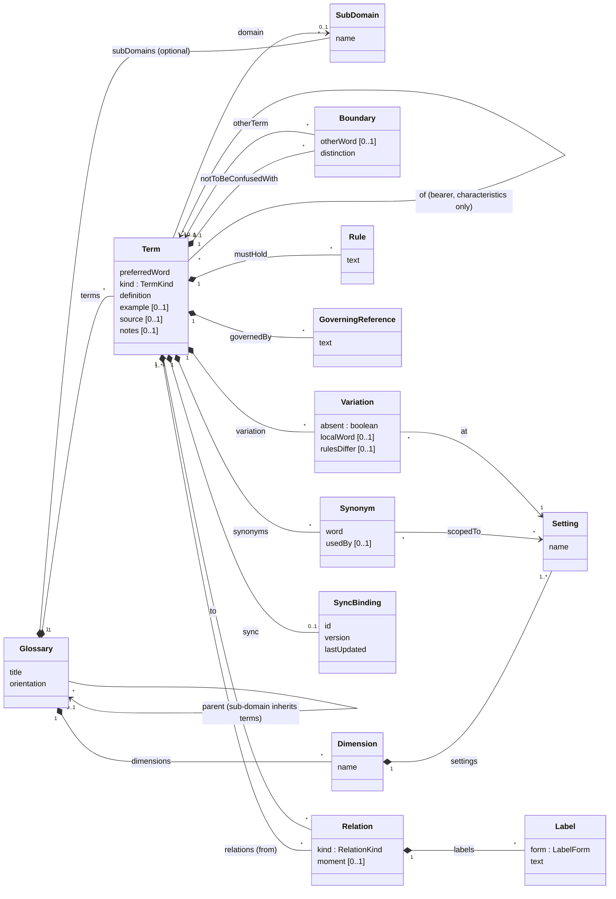

# The glossary model

This README introduces the glossary model that the `glossary` skill works to, and sets out its underlying structure as a
domain model, so that the glossary can be mapped to and from third-party systems (terminology tools, wikis, data
catalogues, thesauri). It is not part of the skill: agents work from [SKILL.md](SKILL.md) and its
[references](references/), which remain the authority on how a glossary is built and kept.

## What a glossary is

A glossary establishes what the terms of a domain mean and how those meanings relate, in a form every stakeholder can
read. It is a **partial concept system**: a connected understanding of the domain's meanings and the distinctions
between them, developed progressively around the areas the work needs. It is deliberately not a domain model:
multiplicity the domain has not stated, lifecycles, full attribute lists, participants in activities and system rules
belong to later work.

The model rests on a few ideas:

- **A term is an entry for one meaning.** In this model, *Term* names a glossary entry representing one domain concept
  or meaning; its preferred word and synonyms are the linguistic designations of that meaning. This is a local
  convention: ISO 704 calls the meaning the *concept* and reserves *term* for a designation. One word naming two
  meanings is two terms here; two words for one meaning is one term with a synonym.
- **Kinds of term.** Every term is an *agent*, a *concept*, an *activity* or a *characteristic* (a property of another
  term, its bearer). The kind reflects how the term is used in this domain, not what the thing intrinsically is.
- **Boundaries.** Each term records what it is not to be confused with, and the line between them. This is what turns
  a word list into a map.
- **Relations have a kind and labels.** Six kinds: three general relations between terms of any kind
  (*is a type of*, *is part of*, *refers to*, broadly ISO 704's generic, partitive and associative relations) and three
  specialised relations from a characteristic (*identifies*, *captures*, *is derived from*). Labels say the relation in the domain's words, as a reading ("an Invoice has at least
  one Line item") or a role ("primary actor"). Kinds imply no multiplicity; a label states it only where the domain does.
- **Rules.** Definitional rules (*must hold*) are part of a term's meaning. Contextual domain rules are referenced
  (*governed by*), and system constraints leave the glossary.
- **Variation without changing meaning.** Across the settings of a dimension (jurisdiction, entity form, market), a
  term may be absent, called differently or governed by different rules, but never mean something different. A
  different meaning is a different term.
- **Domains by folder.** A glossary's folder is its domain. A glossary in a sub-folder belongs to a sub-domain and
  inherits the terms of the glossary above it.
- **Agreed, not annotated.** Evidence status (attested, inferred, proposed) is tracked while terms are drafted. The
  agreed glossary carries none; material doubts remain as open questions in a term's notes.
- **Identity by word.** A glossary that is not synced has no IDs: a term is identified by its preferred word, and a
  renamed term keeps its old word as a synonym. Only a synced glossary carries an external system's identifier,
  version and last-updated time, per term.

## Domain model

The structure behind the Markdown document. The document's summary table and its entries are two presentations of the
same `Term`; nothing here depends on them.

### Notes on the model

| Element | Notes |
|---|---|
| **Glossary** | One Markdown document. Its domain is the folder it lives in; `parent` is the glossary in the folder above, whose terms it inherits and may specialise. |
| **SubDomain** | Only for a glossary that covers several sub-domains in one document. Usually absent: sub-domains are folders. |
| **Term** | Identified by `preferredWord` within its glossary, unless it has a `SyncBinding`. `kind` is required; `of` is required exactly when `kind` is `Characteristic`. |
| **Synonym** | Another designation of the same meaning. A synonym's word must not also designate another term unless scoped (`usedBy`, `scopedTo`) and bounded by a `Boundary` on each. A renamed term's old word becomes a synonym. |
| **Boundary** | Points at another term (`otherTerm`) or, for a neighbour outside the glossary, just names it (`otherWord`). |
| **Relation** | Stored once, on the term it starts from (`from`): the part for *is part of*, the narrower term for *is a type of*, the characteristic for *identifies*, *captures* and *is derived from*. Inverses (*has parts*, *has types*) are derived, never stored. `to` has more than one term only for *is derived from*, which names all its sources. `moment` is required for *captures* ("as at issue") and absent otherwise. A *refers to* normally has at least one label. |
| **Label** | The domain's wording: a `Reading` ("an Invoice has at least one Line item", either direction) or a `Role` ("primary actor", naming the target from the source's side). Any multiplicity is in the label's text, not in a field. |
| **Rule** | A definitional rule. Route alternatives are written within its text. Contextual rules are `GoverningReference`s, not `Rule`s. |
| **Variation** | One per term per setting where the term is not as it is everywhere else. `absent`, `localWord` (a different designation at that setting, also recorded as a scoped synonym) and `rulesDiffer` vary independently. There is no "definition differs": a different meaning is a different term. |
| **SyncBinding** | Present only when the glossary is synced, and only once the external system has seen the term; never invented locally. `lastUpdated` holds the external last-modified time or ETag, for optimistic locking. In the document it is the YAML block under the term's entry heading. |
| **Evidence** | Not in the model: evidence status belongs to drafts. In the agreed glossary, open questions are text in `notes`, prefixed `Open:`. |

### Enumerations

| Enumeration | Value | Meaning |
|---|---|---|
| **TermKind** | `Agent` | Someone or something that acts: a role, an organisation, a body, an external system. |
| | `Concept` | A thing the domain talks about in its own right. |
| | `Activity` | An act or process the domain names as a thing in its own right, usually with a noun (*Audit*, *Settlement*). Most doing is a verb on a glossary noun, left to activity modelling. |
| | `Characteristic` | A property of another term, its bearer (`of`). |
| **RelationKind** | `IsATypeOf` | *is a type of*: the narrower term is a case of the broader, and what the broader term's definition and definitional rules say holds for it too. |
| | `IsPartOf` | *is part of*: the part is understood as a component of the whole. |
| | `RefersTo` | *refers to*: the target exists in its own right and is associated with, not a component of, the source. |
| | `Identifies` | *identifies*: the characteristic is a handle for its bearer. |
| | `Captures` | *captures*: the characteristic is another characteristic as it stood at `moment`. |
| | `IsDerivedFrom` | *is derived from*: the characteristic's meaning is defined in terms of its sources. |
| **LabelForm** | `Reading` | A phrase connecting the two terms as the domain says it, in either direction. |
| | `Role` | A noun phrase naming the target from the source's side, like a property. |

### Relation endpoints

The diagram shows the structure all relations share: one source term, one or more target terms, labels and an
optional moment. Which terms a relation may connect, and what else it requires, depends on its `RelationKind`, as
defined in [references/relations.md](references/relations.md):

| RelationKind | From | To | Also requires |
|---|---|---|---|
| `IsATypeOf` | Any term | Exactly one term of the same kind | |
| `IsPartOf` | Any term, including a characteristic where it clarifies meaning | Exactly one term (the whole) | |
| `RefersTo` | Any term, including a characteristic where it clarifies meaning | Exactly one term | A label, unless the association is self-evident from the two definitions |
| `Identifies` | A characteristic | Exactly one term: the characteristic's own bearer (`of`) | |
| `Captures` | A characteristic | Exactly one characteristic (of another term) | `moment` |
| `IsDerivedFrom` | A characteristic | One or more terms, usually characteristics: all of its sources | |

`moment` is present only on `Captures`, and more than one target only on `IsDerivedFrom`. A characteristic's `of`
(its bearer) is not a `Relation` and implies no `RefersTo`.

## Mapping to third-party systems

Most glossary tools hold a flatter model: a term with a name, a definition, some synonyms and untyped "related terms".
When mapping:

- **Identity.** Use the external system's identifier once it has one (`SyncBinding.id`); until then match on
  `preferredWord`, which is unique within a glossary. Never match on a synonym.
- **Kinds.** Map `kind` to a category, type or tag; most tools have no equivalent field.
- **Relations.** Keep the kind. Where the target system has typed relations, map to them (below); where it has only
  "related terms", carry the kind and labels in the relation's description or a custom attribute, so they survive a
  round trip. Write only stored relations; let the target derive inverses if it can.
- **Boundaries, rules, variation.** Usually free text in the target (scope note, description, custom fields). Keep
  each in its own field where possible, so it can be read back without parsing prose.
- **Versions.** Before pushing, compare `version` or `lastUpdated` with the external record and stop on a mismatch
  rather than overwrite.

### SKOS

[SKOS](https://www.w3.org/TR/skos-reference/), with the ISO 25964 extension for typed hierarchies, is the closest
standard vocabulary and a useful pivot between tools.

**SKOS mappings provide interoperability, not semantic equivalence.** `skos:broader` does not carry the inheritance
that *is a type of* has here (what the broader term's definition and definitional rules say holds for the narrower);
`skos:related` says nothing of what a *refers to*'s reading or role says; and SKOS has no characteristics at all.
Where the target cannot express these, preserve them separately (custom properties, annotations or notes), so that an
integration through SKOS does not silently weaken the glossary.

| Glossary model | SKOS |
|---|---|
| Glossary | `skos:ConceptScheme` |
| Term | `skos:Concept` (in the scheme) |
| preferredWord | `skos:prefLabel` |
| Synonym | `skos:altLabel` |
| definition | `skos:definition` |
| example | `skos:example` |
| Boundary, notes | `skos:scopeNote`, `skos:editorialNote` |
| is a type of | `skos:broader` (`iso-thes:broaderGeneric`) |
| is part of | `iso-thes:broaderPartitive` (`skos:broader` where the extension is unavailable) |
| refers to | `skos:related`, labels as annotations |
| kind, of, identifies, captures, is derived from, rules, variation | No equivalent: custom properties or notes |
