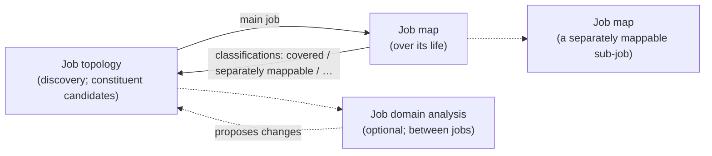
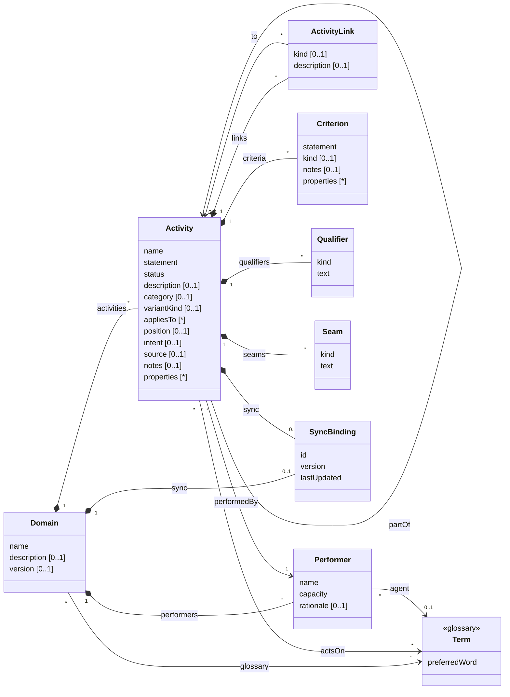

# The job family

The reference for the job family of skills in this plugin: what each skill does, how the family relates to Ulwick's
Outcome-Driven Innovation, the generic activity model the artefacts are built on (reusable for other kinds of activity
analysis), how that model is configured for Jobs to be Done, and how it maps to and from other systems. It sits with `job-help`, which may
draw on it to answer questions about the model. The skills' own `SKILL.md` files and references remain the authority
on how each artefact is built.

## The family

The family models what people in a domain are trying to get done, at the concept level: describing the domain, not a
product. It is written in the words of the domain's glossary, and is built around Jobs to be Done in the
Outcome-Driven Innovation sense (Ulwick).

| Skill | Primary question | Core unit | Artefact |
|---|---|---|---|
| **job-topology** (the head) | What jobs exist, who does them, and where are their boundaries? | Functional job | `job-topology.md`: a compact inventory of jobs and executors, the main job's constituent candidates, open questions and flags |
| **job-domain-analysis** (optional) | How do distinct jobs relate to one another? | Job, relationship | `job-domain-analysis.md`: identity between jobs, relationships, seams, obligations, boundary tests |
| **job-map** | What must be accomplished to get one job done, and how is each part judged? | Job step | One map per job mapped: an inventory of steps by stage, with desired outcomes; classifies the topology's constituent candidates |
| **job-help** | What is all this, and what do I do next? | None | Explanations, and a guided path through the other skills |
| *scenario* (planned) | Does it hold up against a real case? | Case | Concrete stories traced through a job map |

The three modelling skills are analytical capabilities, not a mandatory sequence. Topology and job map refine each
other: the topology proposes, the map tests and reports back. Job domain analysis can come before mapping, after it, or
when a map exposes a problem at the edge of a job;
`job-help` explains and guides, and makes no artefact of its own.

They sit beside the `glossary` skill:

- jobs and steps are **verbs on glossary nouns** (*maintain the membership roll*), and executors are agent terms;
- the glossary holds the nouns, and only those acts the domain names as things in their own right (*Audit*); the doing
  is modelled here.

What the family shares with the glossary: the domain, not the system; evidence (attested, inferred, proposed) tracked
while drafting and agreement before committing; stopping when it is clear enough for the work at hand; Markdown
documents with a summary table and full entries; no IDs unless synced, and then a YAML block per entry.

Deliberately out of scope, as product-level or heavier than the purpose needs: process flow notations (BPMN), journey
maps and service blueprints, story maps, capability maps, Ulwick's consumption-chain and purchase-decision jobs, and
running opportunity surveys (a map's outcomes are written ready for one).

## Ulwick and the extension

**Ulwick-aligned: job topology and job map.** Together they are an Ulwick-aligned method: the topology discovers and
bounds the functional jobs, their executors and the jobs around them; the job map develops a job into the eight
universal stages (Define, Locate, Prepare, Confirm, Execute, Monitor, Modify, Conclude) and its desired outcomes. By
default a job is mapped **over its life**: for a continuing job, one map holds the steps every episode needs, each episode using only those it needs, and
circumstances and edge cases are folded into the steps they change. This is the path to use for ODI research and
outcome harvesting. Ulwick does not prescribe a topology artefact; the family's topology is its own, kept deliberately
light, and is not offered as canonical Ulwick. *Related job* keeps Ulwick's meaning, the executor's other jobs; the
jobs of other executors that touch the main job are **stakeholder jobs**, the family's own word.

**Topology and map refine each other.** Surveying a domain turns up work that seems to make up the main job (taking in
changes, checking, correcting, setting up). The topology records it as **constituent candidates**, each with what was
noticed and a provisional lean, without deciding what it is. Mapping is where the job's internal structure is
discovered, as in Ulwick's iterative mapping: the job map classifies each candidate as **covered** (its work is
represented by the map's steps), **separately mappable** (a distinct functional objective worth a map of its own, at a
finer level), **outside scope** or **unresolved**, and reports back to the topology. Covered and separately mappable
can both hold, and nothing has to be settled before the map proceeds. The focal job's granularity is judged by the
distinctness and coherence of its objective, never by how many steps separately mappable parts cover; a **higher-order
job**, which the focal job is one means to, is a different objective, noted for the topology.

**A job map is an inventory, not a workflow.** Its steps are organised by the stage their function belongs to, not by
order of execution; one occasion of the job may use only some of them. Its completeness is judged by coverage of the
job across its circumstances, and its coherence by the functional relevance of its steps, not by whether they form a
single sequence.

**The extension: job domain analysis.** Going beyond Ulwick, it examines what lies **between** jobs: whether two
candidates are one job or two, whether a candidate belongs to the main job or beside it, whether two people are one
executor; how jobs of different executors relate; where work crosses into the world; the obligations around them; and
whether the boundaries hold. It **enriches the topology without redefining it**, and leaves what happens inside a job
to the job map.

Four ideas are kept distinct throughout, and are not mutually exclusive:

| Idea | Means | Settled by |
|---|---|---|
| **Job identity** | An independently meaningful accomplishment: a functional job | At the boundary, by the topology (and job domain analysis where open); inside a job, by the job map |
| **Decomposition** | A smaller undertaking that contributes to a larger one; a **sub-job** has identity *and* is part of a larger job | Proposed as constituent candidates by the topology; classified by the job map |
| **Episode** | An occurrence of a job, with its trigger | Noticed by the topology (as constituent candidates); classified by the job map |
| **Relationship** | A dependency or interaction between distinct jobs | Described in words in the topology; classified in job domain analysis |

A shared higher-level objective is evidence that jobs are related, not that they are one; a trigger and a completion
do not make a job (steps have both); and a different success criterion is an outcome, not a job.

## Generic activity model

Most activity-modelling techniques share one structure: **units of activity, decomposed into smaller ones, performed
by someone, acting on things the domain names, related to one another, judged by criteria, and varied by case**. They
differ mainly in what they call the units, which classifications they impose, which links they allow, what extra facts
they record and what constraints they add.

The model holds only that shared structure, and says nothing about any one technique. Everything particular to a
technique is declared by a **profile** (below). Jobs to be Done, as this family practises it, is one configuration of
three profiles ([The model configured for Jobs to be Done](#the-model-configured-for-jobs-to-be-done)); other
techniques are further profiles, added without changing the model.

Everything belongs to a **domain**: its activities, its performers, and the facts recorded about them. There is no
separate document entity. What a person reads as a document (a topology, a job map) is a **view**: one activity, and
what a profile reaches from it ([Views](#views)). The domain is versioned as a whole, and it is the same domain the
glossary uses, so activities, performers and terms share one scope.

*Activity* is the generic unit. It is not the glossary's Activity kind, which is a word the domain uses; an activity
here may involve several such words.

### Elements

| Element | Notes |
|---|---|
| **Domain** | The scope everything belongs to: the area of the business being analysed, the same as the glossary's domain (in files, the folder that stands for it). It owns the activities and performers, and is versioned as a whole: agreeing a change is recording a new `version` of the domain. |
| **Activity** | The generic unit. `name` identifies it within its domain; `statement` is its full form; `description` says what it covers, without breaking it into sub-activities. `category` is a value from a profile's classification. `position` orders it among its siblings where the profile gives order a meaning. `intent` is the result its performer is pursuing: what distinguishes one activity from another. `status` is `proposed` or `agreed`; each profile says what makes an activity agreed. An activity may be the **primary activity** of one or more views. |
| **partOf** | Decomposition: an activity that is part of a larger one. Whether the part keeps an identity of its own is for the profile to record, usually through its `category`. Profiles limit the depth. |
| **Variants** | A **variant** is an activity that says what another activity (its **core**) must accomplish, or what changes, in a particular case: it is `partOf` its core, shares its `category`, and has a `variantKind` and an `appliesTo` naming the case. Kinds are profile-defined (a situation, a particular kind of thing, a market, a channel). `appliesTo` names one case or several sharing the same statement, as text kept consistent by the profile's naming rule, not a separate entity. A variant never changes its core's intent. |
| **Performer** | Who performs an activity, by `capacity` (the responsibility carried), not title; resolves to an agent term in the glossary. `rationale` records what was unified or split, and why. |
| **actsOn** | The glossary nouns an activity's statement uses. In files these are words in the statement, not a field; drift checks compare them with the glossary. |
| **ActivityLink** | A link between two distinct activities, other than decomposition. `kind` is a profile-defined value (a relationship, a sequence, a dependency), and may be absent where a profile describes links in words; `description` says what the link is. |
| **Criterion** | How success of an activity is judged. `statement` is the criterion as written; `kind` and `properties` carry any form the profile imposes (an outcome statement's parts, an acceptance criterion's conditions, a service level's target). `notes` holds what must survive agreement about the criterion itself (to be validated; derived from a qualifier; its measure to be settled). |
| **Qualifier** | A further dimension of an activity that holds whatever the case (an emotional or social aim, a regulatory note); `kind` is profile-defined. A profile may require qualifiers to be turned into criteria. |
| **Seam** | Where execution leaves any system: it `happensInWorld`, `arrivesFromWorld`, or runs `bothWays` (the act inside gives the change outside its effect). |
| **properties** | Facts recorded on an activity or a criterion, as a name and a value. A value may be simple (a word, a number), a structured record with named fields, or a list of either. What a view finds about its primary activity (a map's circumstances and coverage, a topology's open questions) is recorded as properties of that activity. **Every property name is declared once, by the profile or profiles that use it, and never means different things in different profiles**, so a property's name says which method recorded it. |
| **SyncBinding** | Present only when synced with an external system; never invented. On the domain, it records the version synced; on an activity, the external record's id. In files it is the YAML block under an entry's heading. |
| **Evidence** | Not in the model: evidence marks (attested, inferred, proposed as a modelling choice) belong to drafts and are dropped on agreement. They are not an activity's `status`, which records only whether it has been agreed. Open questions are text in `notes`, prefixed `Open:`. |

### Views

A **view** is one activity, its **primary activity**, together with everything a profile reaches from it: its parts,
the activities linked to it, and the properties the profile records on them. A topology is the view of a main job by
the topology profile; a job map is the view of a job by the job map profile. Views are not stored: they are derived
from the domain whenever they are read, rendered or synced.

The same activity can be the primary activity of several views, one per profile applied to it. Whether a profile has
been applied is read from the domain itself: a job has been mapped if it has steps with a stage `category`.

In the family's Markdown files, each file is a view written down: `job-topology.md` is the topology view of the main
job, and `job-maps/<job>.md` the job map view of that job. The files together are the domain's storage, and an
external system may hold the same views as pages or records. A file never owns anything another file refers to: a job
named in several files is one activity of the domain.

### Profiles

A profile configures the model for one technique. It is a set of declarations, not something instantiated. It
declares:

- what it calls the activity, and what can be a primary activity;
- its **reach**: from a primary activity, what a view includes (its parts, the activities linked to it, or both, and
  of which categories);
- its `category` values, disjoint from other profiles' so that a category says which profile placed an activity, and
  how deep `partOf` may go;
- its link kinds, and between what they run;
- which variant kinds and qualifier kinds it uses, and its naming rule for `appliesTo`;
- the form of its criteria;
- the properties it records, with their names, fields and the activities that carry them;
- what makes an activity's `status` agreed;
- the constraints that tie them together.

Adding a technique is a matter of writing those down, not of changing the model. For example (illustrations of the
pattern, not skills in this plugin):

| Technique | Primary activity | Activity is | category | partOf | ActivityLink | Criterion |
|---|---|---|---|---|---|---|
| Value chain (Porter) | The firm's value-creating activity | Activity | Primary, support | Optional: activity → sub-activity | Not used | Not used |
| Hierarchical task analysis | The top goal | Goal, subgoal, operation | Level | Recursive, any depth | Plan (when each sub-task is done) | Performance standard |
| User story map (Patton) | The user's overall activity | Activity, task, story | Backbone, walking skeleton, release | Activity → task → story | Sequence along the backbone | Acceptance criteria |
| Process model (swimlane, BPMN) | The process | Process, step | Task, decision, event | Process → step | Sequence, condition, message | Service level |
| Event partitioning (essential systems analysis) | The system's purpose | Planned response | External, temporal event | Response → step | Triggered by (an event) | Not used |

## The model configured for Jobs to be Done

The job family configures the generic model as three profiles: the **job topology**, **job domain analysis** and the
**job map**. They share one set of values and properties, declared once here. The skills remain the authority on what
each value means in practice; this section says how they land in the model.

**Jobs belong to the domain; the topology is the agreed view of them.** A job named anywhere (a map's job before any
topology exists, a higher-order job, a stakeholder job a map finds) is a job of the domain, with `status: proposed`.
It becomes `agreed` when the topology view reaches it (it is the main job, or carries a topology category and is part
of or linked to the main job) in an agreed version of the domain. A step becomes `agreed` with the version in which
its map is agreed.

### The three profiles

| Model element | Job topology | Job domain analysis | Job map |
|---|---|---|---|
| Primary activity | The main job (exactly one per domain) | The main job | Any job of the domain: the main job, a sub-job, a related job; one not yet agreed is `proposed` |
| Reach | Jobs part of or linked to the main job, with a topology category; their executors | The jobs it takes up, linked to the main job or to each other around it | Steps part of the job, with a stage category, and their variants; jobs it links to |
| Activity | Job (and sub-jobs) | Job | Step, and its variants |
| Performer | Job executor | The topology's executors | The job's executor |
| intent | The job's desired result; with `successCriteria` and `scope` kept beside the statement | As the topology | Not used: a step serves its job's intent |
| partOf | Sub-jobs to the main job | Not used | Every step to the job; variants to their core step |
| position | Not used | Not used | Order within a stage, as the executor would describe it; the stage gives the grouping |
| ActivityLink | Related and stakeholder jobs to the main job, in words; `MeansTo` from the main job to a higher-order job | Classified relationships, each to the most specific job it bears on | `MeansTo` from the job to a higher-order job it proposes |
| Criterion | Not used | Not used | Desired outcomes, usually two to four per significant step once researched |
| Qualifier | Emotional and social, on jobs | Not used | Turned into criteria on the steps they bear on |
| Variants | Circumstances on jobs | Not used | `EdgeCase` and `Circumstance` variants of core steps, only where the step changes |
| Seam | Flagged (`flags`) | Direction settled | Marked on steps |
| Agreed when | The topology view reaches the job in an agreed version | Its findings are agreed with the version | The map is agreed with the version |

### The eight stages

The job map's `category` is one of Ulwick's eight universal stages. A step is placed by its functional purpose, not by
when it happens; the stages organise an inventory, not a sequence.

| Stage | The executor must… |
|---|---|
| `Define` | determine what needs to be done, considered or achieved |
| `Locate` | gather the inputs, information, resources or items required |
| `Prepare` | arrange or ready what is needed |
| `Confirm` | verify readiness, assumptions, conditions or prerequisites |
| `Execute` | perform the central activity: the actions that accomplish the job |
| `Monitor` | assess progress, state, performance or emerging conditions |
| `Modify` | adjust in response to a problem that has been found |
| `Conclude` | complete the job, or a piece of work within it, and establish the resulting state |

### Values and kinds

| Declared | Values |
|---|---|
| `category` (topology) | `Main`, `SubJob` (a constituent the job map found separately mappable), `Related` (the same executor's other job, in Ulwick's sense), `Stakeholder` (another executor's job that touches the main job). Disjoint from the stages, so a sub-job and a step, both `partOf` the main job, are told apart by category |
| `category` (domain analysis) | None of its own: it uses the topology's |
| `category` (job map) | The eight stages, above |
| `variantKind` | `Core` (default), `EdgeCase` (a particular kind of thing the job deals with; `appliesTo` is the glossary's preferred word), `Circumstance` (a situation the whole job is done in; `appliesTo` is its label in the job's `circumstances`) |
| `ActivityLink.kind` | Domain analysis: `Changes`, `Enables`, `Constrains`, `Governs`, `Consumes`, `RespondsTo`. Topology: otherwise described in words; a related job may be `Before`, `After` or `Alongside`. Topology and job map: `MeansTo` (the job is one means to a higher-order job: buying a property to *secure a place to live*) |
| `status` | `proposed`, `agreed`, by the rule above |
| `Qualifier.kind` | `Emotional`, `Social` |
| `Criterion` | Job map only: a desired outcome, with properties `direction` (minimise, increase), `measure` (time, likelihood, variability, number, effort), `object`, `clarifier`; `notes` for what must survive agreement (to validate, as for an outcome that encodes a decision strategy; derived from a qualifier; measure to settle) |

### Properties

Each name is declared once and means one thing; *Profile* says which method records it. Properties a view records
about its primary activity sit on that activity.

| Property | On | Profile | Meaning |
|---|---|---|---|
| `framing` | The main job | Topology | The topology's opening prose: the executor and main job in full, and any sub-domain split already evident |
| `constituents` | The main job | Topology | Each constituent candidate, with its `trigger`, what was noticed, its `lean` (likely an episode, likely a step, possibly a job, unclear) and its `status` (open, or the map's classifications) |
| `scope` | A job, chiefly the main job | Topology | What the job's object takes in and leaves out, kept out of its statement |
| `successCriteria` | A job, chiefly the main job | Topology | How the executor judges the whole job, kept out of its statement; not desired outcomes |
| `edgeCases` | The main job | Topology | The cases its object's breadth was tested against, each with its finding |
| `openClassifications` | The main job | Topology | Boundary questions the five tests genuinely split on, each with its evidence |
| `subDomainHypotheses` | The main job | Topology | Each, with the signal that prompted it |
| `boundaryQuestions` | The main job | Topology | Questions about the main job's edge left open |
| `flags` | The main job | Topology | Seams, obligations and supplying, for deeper analysis |
| `leftOut` | The main job | Topology | Jobs considered and left out, with why |
| `identity` | A job taken up on a boundary question | Topology, domain analysis | One job or two; part of the main job or beside it; one executor or two; with the five tests' findings behind it |
| `obligations` | The main job | Domain analysis | Each obligation, with where it is placed or why it is open |
| `boundaryTests` | The main job | Domain analysis | The exceptional cases, settings and changes tried, and what each showed |
| `topologyProposals` | The main job | Domain analysis | Changes to the topology the analysis proposes that are not already proposed jobs or links (merging or splitting executors, say) |
| `standard` | Any job or step whose result is assurance | All | `consistency` or `correctness` |
| `preCheck` | A mapped job | Job map | The map's opening prose: how it is mapped and what it found before the steps |
| `mapping` | A mapped job | Job map | Over its life (the default), or a sub-job on its own |
| `circumstances` | A mapped job | Job map | The circumstances the job is done in, declared once: each with its `label` (C1, C2, …) and `description`; a `Circumstance` variant's `appliesTo` names one |
| `episodes` | A mapped job | Job map | For a continuing job, each episode with its trigger and the steps it uses; a step entry's *Episodes* is the inverse view |
| `classifications` | A mapped job | Job map | Each constituent candidate: `covered` (with the steps), `separatelyMappable`, `outsideScope`, `unresolved` (with why); covered and separately mappable may both hold |
| `coverage` | A mapped job | Job map | Each circumstance, and each significant edge case: the steps that cover it, and the finding (covered, a gap, an ambiguous boundary, possibly another job) |
| `emptyStages` | A mapped job | Job map | Stages that yielded nothing, and what each suggests about the boundary |
| `order` | A step | Job map | Where it helps: that the step runs alongside another, repeats, is done on demand, or returns to another step. Never a required sequence |

### Constraints

**Job topology**

- Exactly one main job per domain.
- A job is `agreed` once the topology view reaches it in an agreed version of the domain, and `proposed` until then,
  whichever file named it.
- A related job has the main job's performer and a different intent; a stakeholder job has a different performer.
- Performers are one only if they pursue the same intent, never because they stand to another activity the same way;
  two stakeholder jobs with the same relationship to the main job but different intents remain separate.
- A different motivation for the same functional objective is not a different job; a higher-order job the main job is
  one means to is a different job, linked by `MeansTo`, not a restatement of it.
- Work that seems to make up the main job is recorded in `constituents`, with a lean but no verdict, until a job map
  classifies it.
- Boundary questions the evidence does not settle go in `openClassifications`, not forced; a shared higher-level
  objective never settles identity on its own.

**Job domain analysis**

- It refers to the domain's jobs and does not define its own; jobs it concludes are missing or wrong go to
  `topologyProposals`, or are proposed as jobs, for the topology to agree.
- It works between jobs and leaves their internal structure to their maps.
- Identity is settled by weighing the five tests, never by a shared objective, performer, trigger, source or success
  criterion alone.
- Every relationship has a kind and runs to the most specific job it bears on.

**Job map**

- Its primary activity is a job of the domain: agreed, or `proposed` where the map is made before a topology exists.
  Every step has the job's performer (delegated work stays the performer's).
- Circumstances are declared once, in `circumstances`; every `Circumstance` variant names one of them.
- Jobs the map finds that are not its own (higher-order, stakeholder, separately mappable) are proposed to the domain,
  for the topology to agree; the map does not make them agreed.
- One level of steps; a core step may have variants (part of it, in its stage, with a `variantKind` and an
  `appliesTo`, and no variants of their own).
- Each step is placed in a stage by its functional purpose, none filled for its own sake; Execute is not defined by
  irreversibility, and Confirm need not precede it in every circumstance. Steps are presented grouped by stage.
- The steps are an inventory, not a sequence, and need not all be used by any one occasion of the job. A step that a
  different method would remove without losing a necessary accomplishment is a means, not a step.
- A job is mapped over its life by default, with circumstances and edge cases as variants of the steps they change.
  Completeness is tested by coverage of each circumstance.
- Every constituent candidate is classified, and each classification is reported to the topology without holding the
  map up. Separate mappability is judged by objective, never by a sequence of its own; overlap with the parent's map
  is expected. Granularity is judged by the job's objective, never by counting steps.
- Criteria take the outcome form; their completeness is judged separately from the steps', they are checked against
  the executor's capacity and the domain's causal rules, and tensions between them are recorded, not resolved.
- Conclude steps must be accomplishments the job needs. The choice of map never changes what the jobs are.

## Mapping to other systems

- **Matching.** Use an external system's identifier once it has one (`SyncBinding.id`); until then match on an
  activity's `name` within its domain.
- **Scope.** Map the domain to the target's container for a body of work (a project, a space, a folder); activities
  and performers are created there once. Where the target holds documents or pages, each is a view (a primary
  activity and what its profile reaches), and refers to the activities rather than copying them.
- **Status.** Carry `proposed` and `agreed` as a status or tag, so a proposed job is not read back as agreed.
- **Hierarchy.** Most tools hold a tree (initiative → epic → story, process → step, job → step). Map `partOf` to it and
  `category` to a type or tag, and keep the profile so the tree can be read back with the right labels.
- **Variants.** Map a variant to a child record, note or conditional field of its core activity, keeping its
  `variantKind` and `appliesTo` (as a tag or condition). Where the target has none of these, write variants into the
  core activity's description as `<appliesTo>: <statement>`, so they can be read back.
- **Properties.** Map profile properties to custom fields where the target has them; otherwise to tags or a structured
  block in the description, keeping their names so they can be read back.
- **Links.** Keep the link kind; where the target has only untyped links, carry the kind in a custom attribute.
- **Criteria.** Tools built around Outcome-Driven Innovation hold jobs, steps and outcomes natively; elsewhere criteria
  map to child records or a structured field of their activity, never pooled at a higher level.
- **Versions.** The domain is versioned as a whole. Before pushing, compare the domain's synced `version`, and each
  record's `version` or `lastUpdated`, with the external system, and stop on a mismatch.
