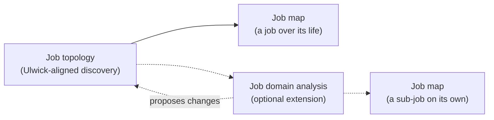
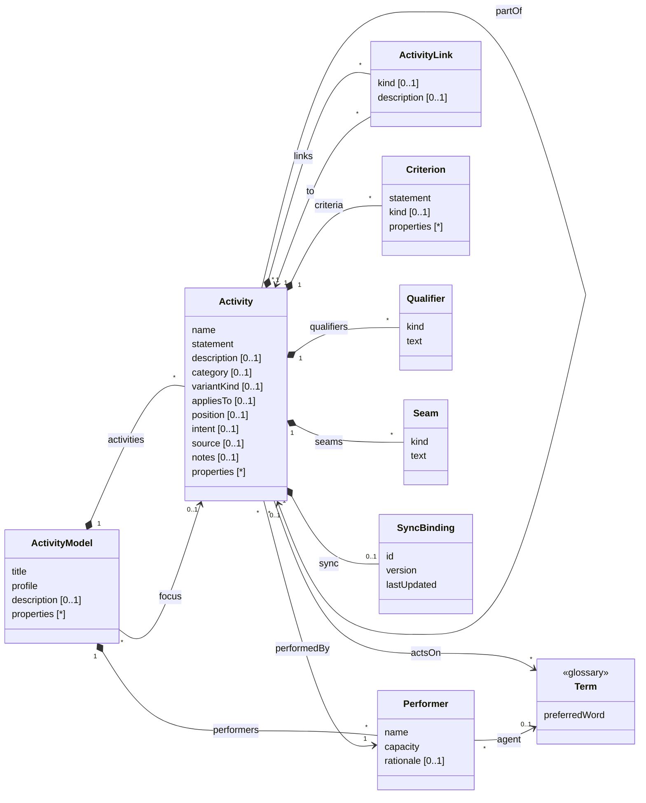

# The job family

The reference for the job family of skills in this plugin: what each skill does, how the family relates to Ulwick's
Outcome-Driven Innovation, and the generic activity model the artefacts are built on, so that they can be mapped to and
from other systems and the same model reused for other kinds of activity analysis. It sits with `job-help`, which may
draw on it to answer questions about the model. The skills' own `SKILL.md` files and references remain the authority
on how each artefact is built.

## The family

The family models what people in a domain are trying to get done, at the concept level: describing the domain, not a
product. It is written in the words of the domain's glossary, and is built around Jobs to be Done in the
Outcome-Driven Innovation sense (Ulwick).

| Skill | Primary question | Core unit | Artefact |
|---|---|---|---|
| **job-topology** (the head) | What jobs exist, who does them, and where are their boundaries? | Functional job | `job-topology.md`: a compact inventory of jobs and executors, with open classifications and flags |
| **job-domain-analysis** (optional) | How do the jobs fit together? | Job, decomposition, episode, relationship | `job-domain-analysis.md`: identity and decomposition, episodes, relationships, seams, obligations, boundary tests |
| **job-map** | What must be accomplished to get one job done, and how is each part judged? | Job step | One map per job mapped: steps by stage, with desired outcomes |
| **job-help** | What is all this, and what do I do next? | None | Explanations, and a guided path through the other skills |
| *scenario* (planned) | Does it hold up against a real case? | Case | Concrete stories traced through a job map |

The three modelling skills are analytical capabilities, not a mandatory sequence. A job map can be made straight from a
topology; job domain analysis can come before mapping, after it, or when a map exposes an unresolved boundary;
`job-help` explains and guides, and makes no artefact of its own.

They sit beside the `glossary` skill:

- jobs and steps are **verbs on glossary nouns** (*maintain the membership roll*), and executors are agent terms;
- the glossary holds the nouns, and only those acts the domain names as things in their own right (*Audit*); the doing
  is modelled here.

What the family shares with the glossary: the domain, not the system; evidence (attested, inferred, proposed) tracked
while drafting and agreement before committing; stopping when it is clear enough for the work at hand; Markdown
documents with a summary table and full entries; no IDs unless synced, and then a YAML block per entry.

Deliberately out of scope, as product-level or heavier than the purpose needs: process flow notations (BPMN), journey
maps and service blueprints, story maps, capability maps, Ulwick's consumption-chain and purchase-decision jobs, and
running opportunity surveys (a map's outcomes are written ready for one).

## Ulwick and the extension

**Ulwick-aligned: job topology and job map.** Together they are an Ulwick-aligned method: the topology discovers and
bounds the functional jobs, their executors and the jobs around them; the job map develops a job into the eight
universal stages (Define, Locate, Prepare, Confirm, Execute, Monitor, Modify, Conclude) and its desired outcomes. By
default a job is mapped **over its life**: for a continuing job, each episode passes through the stages it needs, and
circumstances and edge cases are folded into the steps they change. This is the path to use for ODI research and
outcome harvesting. Ulwick does not prescribe a topology artefact; the family's topology is its own, kept deliberately
light, and is not offered as canonical Ulwick.

**The extension: job domain analysis.** Going beyond Ulwick, it examines what the topology leaves open: whether
candidates are jobs of their own, parts of larger jobs or episodes; how continuing jobs are done; how jobs of different
executors relate; where work crosses into the world; and whether the boundaries hold. It **enriches the topology
without redefining it**: it refers to the topology's jobs, and proposes changes to the topology rather than keeping a
second list of jobs.

**What the extension adds to mapping.** Where job domain analysis finds that a larger job is made up of **sub-jobs**
(parts with job identity of their own), the job map may map a sub-job on its own, as one progression from its
beginning to its completion, alongside or instead of the larger job's map over its life. The two are complementary
views; choosing one never changes what the jobs are.

Four ideas are kept distinct throughout, and are not mutually exclusive:

| Idea | Means | Settled by |
|---|---|---|
| **Job identity** | An independently meaningful accomplishment: a functional job, worth mapping on its own | The topology where clear; job domain analysis where open |
| **Decomposition** | A smaller undertaking that contributes to a larger one; a **sub-job** has identity *and* is part of a larger job | Job domain analysis |
| **Episode** | An occurrence of a job, with its trigger | Noted in the topology; classified in job domain analysis |
| **Relationship** | A dependency or interaction between distinct jobs | Described in words in the topology; classified in job domain analysis |

A shared higher-level objective is evidence that jobs are related, not that they are one: inspecting, servicing and
repairing vehicles all serve a roadworthy fleet and may still be distinct jobs.

## A generic activity model

Most activity-modelling techniques share one structure: **units of activity, decomposed into smaller ones, performed
by someone, acting on things the domain names, related to one another, judged by criteria, and varied by case**. They
differ mainly in what they call the units, which classifications they impose, which links they allow, what extra facts
they record and what constraints they add.

The model below holds only that shared structure. Everything particular to a technique is supplied by a **profile**:
its labels, its classification values, its link kinds, the **properties** it records, and its constraints. The job
topology, job domain analysis and job map are three profiles; other techniques are further profiles, added without
changing the model.

In the model, *Activity* is the generic unit: a job in a topology or analysis, a step in a map. It is not the
glossary's Activity kind, which is a word the domain uses; an activity here may involve several such words.

### Notes on the model

| Element | Notes |
|---|---|
| **ActivityModel** | One document of one profile (a topology, an analysis, a map, or another technique's artefact). `profile` names the profile, and so the labels, values, properties and constraints that apply. `focus` is the activity the document is about. `description` is its opening prose. |
| **Activity** | The generic unit. `name` identifies it within its model; `statement` is its full form; `description` says what it covers, without breaking it into sub-activities. `category` is a value from the profile's classification. `position` orders it among its siblings where order matters. `intent` is the result its performer is pursuing: what distinguishes one activity from another, and decides whether two performers are one (they are one only if they pursue the same intent, never because they stand to another activity the same way). |
| **partOf** | Decomposition: an activity that is part of a larger one, in the same model or another (a map's steps are part of a job in a topology). Whether the part keeps an identity of its own is for the profile to record. Profiles limit the depth. |
| **Variants** | A **variant** is an activity that says what another activity (its **core**) must accomplish, or what changes, in a particular case: it is `partOf` its core, shares its `category`, and has a `variantKind` and an `appliesTo` naming the case. Kinds are profile-defined (a situation, a particular kind of thing, a market, a channel). `appliesTo` is text kept consistent by the profile's naming rule, not a separate entity. A variant never changes its core's intent. |
| **Performer** | Who performs an activity, by `capacity` (the responsibility carried), not title; resolves to an agent term in the glossary. `rationale` records what was unified or split, and why. |
| **actsOn** | The glossary nouns an activity's statement uses. In documents these are words in the statement, not a field; drift checks compare them with the glossary. |
| **ActivityLink** | A link between two distinct activities, other than decomposition. `kind` is a profile-defined value (a relationship, a sequence, a dependency), and may be absent where a profile describes links in words; `description` says what the link is. |
| **Criterion** | How success of an activity is judged. `statement` is the criterion as written; `kind` and `properties` carry any form the profile imposes (the job map's outcome form, an acceptance criterion's conditions, a service level's target). |
| **Qualifier** | A further dimension of an activity that holds whatever the case (an emotional or social aim, a regulatory note); `kind` is profile-defined. A profile may require qualifiers to be turned into criteria. |
| **Seam** | Where execution leaves any system: it `happensInWorld`, `arrivesFromWorld`, or runs `bothWays` (the act inside gives the change outside its effect). |
| **properties** | Profile-defined facts recorded on a model, an activity or a criterion, as name and value (or a list of values). The model fixes only that they exist; each profile declares which properties it uses, where, and what they mean. |
| **SyncBinding** | Present only when synced with an external system; never invented. In documents it is the YAML block under an entry's heading. |
| **Evidence** | Not in the model: evidence status belongs to drafts. Open questions are text in `notes`, prefixed `Open:`. |

### The job family's profiles

The three profiles share one set of values and properties, declared once here:

| Declared | Values or meaning |
|---|---|
| `category` (topology) | `Main`, `Adjacent`, `Related` |
| `category` (domain analysis) | `SubJob`, `Episode`, plus the topology's categories for the jobs it refers to |
| `category` (job map) | `Define`, `Locate`, `Prepare`, `Confirm`, `Execute`, `Monitor`, `Modify`, `Conclude` |
| `variantKind` | `Core` (default), `EdgeCase` (a particular kind of thing the job deals with; `appliesTo` is the glossary's preferred word), `Circumstance` (a situation the whole job is done in; `appliesTo` is its label as listed with the map) |
| `ActivityLink.kind` | Domain analysis: `Changes`, `Enables`, `Constrains`, `Governs`, `Consumes`, `RespondsTo`. Topology: none (described in words); an adjacent job may be `Before`, `After` or `Alongside`. Job map: `Serves` (a step to an episode passing through it) |
| `Qualifier.kind` | `Emotional`, `Social` |
| `Criterion` | Job map only: a desired outcome, with properties `direction`, `measure`, `object`, `clarifier` |
| Model properties | `openClassifications` (only where the five tests genuinely split, each with its evidence), `subDomainHypotheses` (each with its signal), `boundaryQuestions`, `flags` (seams, obligations, supplying): topology. `mapping` (over its life, or a sub-job on its own): job map |
| Activity properties | `identity` (functional job, step, episode, undecided), with the five tests' findings behind it: proposed in the topology, settled in more depth in domain analysis. `trigger` (event-driven, periodic, exceptional), `immediateResult`, `completion`: on episodes. `standard` (consistency, correctness): on any activity whose result is assurance. `edgeCases` tried (each with its finding): on the topology's main job |

| Pattern element | Job topology | Job domain analysis | Job map |
|---|---|---|---|
| ActivityModel | Topology (one per domain) | Analysis (one per domain, optional; refers to the topology's jobs) | Job map (one per job mapped) |
| focus | The main job | The main job, or the jobs taken up | The job mapped: any job in the topology, or a sub-job |
| Activity | Job | Job, sub-job, episode | Step, and its variants |
| partOf | Not used (episodes are noted on the job's entry) | Sub-jobs and episodes to their job; a sub-job keeps its identity; more than two levels is suspect | Every step to the focus job; variants to their core step |
| ActivityLink | Adjacent and related jobs to the main job, in words | Classified relationships, each to the most specific job it bears on | `Serves`, where useful |
| Criterion | Not used | Not used | Desired outcomes, usually two to four per significant step |
| Qualifier | Emotional and social, on jobs | Not used | Turned into criteria on the steps they bear on |
| Variants | Circumstances on jobs | Not used | `EdgeCase` and `Circumstance` variants of core steps, only where the step changes |
| Seam | Flagged (`flags`) | Direction settled | Marked on steps |
| Properties used | `openClassifications`, `subDomainHypotheses`, `boundaryQuestions`, `flags`; `identity` where clear; `trigger` on episodes; `edgeCases` on the main job | `identity` on each candidate taken up; `trigger`, `immediateResult`, `completion` on episodes; `standard` | `mapping`; `standard`; outcome properties on criteria |

**Constraints of the job topology**: exactly one main job; an adjacent job has the main job's performer and a different
intent; a related job has a different performer; two related jobs with the same relationship to the main job but
different intents remain separate; classifications the evidence does not settle are recorded in
`openClassifications`, not forced; a shared higher-level objective never settles identity on its own. The topology is
the authoritative list of jobs and executors.

**Constraints of job domain analysis**: it refers to the topology's jobs and does not define its own; a sub-job has the
same performer as its larger job and keeps its own identity; identity is settled by weighing several tests, never by a
shared objective, performer, trigger or source alone; every relationship has a kind and runs to the most specific job it
bears on; changes to the topology are proposed there, not made here.

**Constraints of the job map**: one focus job, which is in the topology (or a sub-job recorded by an analysis); one
level of steps, where a core step may have variants (part of it, in its stage, with a `variantKind` and an
`appliesTo`, and no variants of their own); every step has the focus job's performer; categories are the eight step
types, none filled for its own sake; criteria take the outcome form. A job is mapped over its life by default (each
episode passes through the stages it needs; circumstances and edge cases as variants of the steps they change); a
sub-job may be mapped on its own as one progression. The choice of map never changes what the jobs are.

### Other profiles

The same structure fits other activity models by relabelling and constraining it. These are illustrations of the
pattern, not skills in this plugin:

| Technique | Activity is | category | partOf | ActivityLink | Criterion |
|---|---|---|---|---|---|
| Value chain (Porter) | Activity | Primary, support | Optional: activity → sub-activity | Not used | Not used |
| Hierarchical task analysis | Goal, subgoal, operation | Level | Recursive, any depth | Plan (when each sub-task is done) | Performance standard |
| User story map (Patton) | Activity, task, story | Backbone, walking skeleton, release | Activity → task → story | Sequence along the backbone | Acceptance criteria |
| Process model (swimlane, BPMN) | Process, step | Task, decision, event | Process → step | Sequence, condition, message | Service level |
| Event partitioning (essential systems analysis) | Planned response | External, temporal event | Response → step | Triggered by (an event) | Not used |

A profile is defined by: what it calls the model and the activity; its `category` values; the depth of decomposition;
its link kinds and between what they run; which variant kinds and qualifier kinds it uses, and its naming rule for
`appliesTo`; the form of its criteria; the properties it records, and where; and the constraints that tie them
together. Adding a profile is a matter of writing those down, not of changing the model.

## Mapping to other systems

- **Matching.** Use an external system's identifier once it has one (`SyncBinding.id`); until then match on an
  activity's `name` within its model.
- **Hierarchy.** Most tools hold a tree (initiative → epic → story, process → step, job → step). Map `partOf` to it and
  `category` to a type or tag, and keep the profile so the tree can be read back with the right labels.
- **Variants.** Map a variant to a child record, note or conditional field of its core activity, keeping its
  `variantKind` and `appliesTo` (as a tag or condition). Where the target has none of these, write variants into the
  core activity's description as `<appliesTo>: <statement>`, so they can be read back.
- **Properties.** Map profile properties to custom fields where the target has them; otherwise to tags or a structured
  block in the description, keeping their names so they can be read back.
- **Links.** Keep the link kind; where the target has only untyped links, carry the kind in a custom attribute.
- **Criteria.** Tools built around Outcome-Driven Innovation hold jobs, steps and outcomes natively; elsewhere criteria
  map to child records or a structured field of their activity, never pooled at a higher level.
- **Versions.** Before pushing, compare `version` or `lastUpdated` with the external record and stop on a mismatch.
