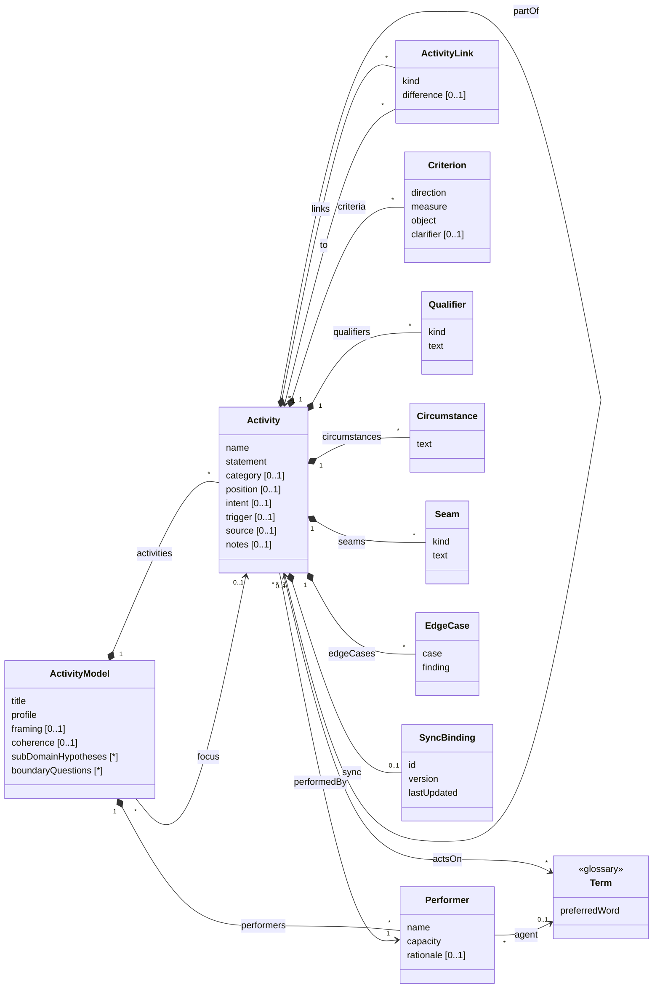

# The job family

This README introduces the family of activity-modelling skills headed by `job-topology`, and sets out their underlying
structure as a domain model, so that the artefacts can be mapped to and from other systems and the same pattern can be
reused for other kinds of activity model. It is not part of any skill: agents work from each skill's `SKILL.md` and
its references, which remain the authority on how the artefacts are built.

## The family

The family models what people in a domain are trying to get done, at the concept level: describing the domain, not a
product. It is oriented around Jobs to be Done in the Outcome-Driven Innovation sense (Ulwick), and written in the
words of the domain's glossary.

| Skill | Answers | Artefact |
|---|---|---|
| **job-topology** (the head) | Who is trying to get what done, and which jobs surround the main one? | One topology per domain: executors, a main job with its episodes, constituent, adjacent and related jobs, framing |
| **job-map** | What does it take to get one job done, and how does the executor judge each part done well? | One map per job: steps by type, with desired outcomes |
| *scenario* (planned) | Does it hold up against a real case? | Concrete stories traced through a job map in the glossary's words |

They sit beside the `glossary` skill:

- jobs and steps are **verbs on glossary nouns** (*maintain the record of share ownership*), and executors are agent
  terms;
- the glossary holds the nouns, and only those acts the domain names as things in their own right (*Audit*); the doing
  is modelled here.

What the family shares with the glossary: the domain, not the system; evidence (attested, inferred, proposed) tracked
while drafting and agreement before committing; stopping when it is clear enough for the work at hand; Markdown
documents with a summary table and full entries; no IDs unless synced, and then a YAML block per entry.

Deliberately out of scope, as product-level or heavier than the purpose needs: process flow notations (BPMN), journey
maps and service blueprints, story maps, capability maps, Ulwick's consumption-chain and purchase-decision jobs, and
running opportunity surveys (a map's outcomes are written ready for one).

## A generic activity model

Most activity-modelling techniques share one structure: **units of activity, decomposed into smaller ones, performed
by someone, acting on things the domain names, related to one another, and judged by criteria**. They differ mainly in
what they call the units, which classifications they impose, which links they allow and what constraints they add. The
job topology and the job map are two **profiles** of that structure, and other techniques (at higher or lower
altitudes) can be expressed as further profiles.

In the model below, *Activity* is the generic unit: a job in a topology, a step in a map. It is not the glossary's
Activity kind, which is a word the domain uses; an activity here may involve several such words.

### Notes on the model

| Element | Notes |
|---|---|
| **ActivityModel** | One document: a topology or a job map. `profile` says which, and so which labels and constraints apply. `focus` is the activity the model is about: the main job of a topology, the job a map opens up. `framing` is the opening prose; `coherence` records the coherence test (the progressions compared and the conclusion); `subDomainHypotheses` (each with the signal that prompted it) and `boundaryQuestions` (left open on purpose, such as whether an obligation completes a change or belongs to a separate job) are kept as lists so they can be found and counted. |
| **Activity** | The generic unit. `name` identifies it within its model (verb + glossary noun); `statement` is the full form. `category` is a value from the profile's classification. `position` orders it among its siblings where order matters, loosely. `intent` is the result its performer is pursuing: the desired outcome of the activity as a whole (not to be confused with a `Criterion`, which judges how well a part of it is done). Intent is what distinguishes activities and performers: two activities with the same performer are separate jobs only if their intents differ, and two performers are one only if they pursue the same intent. `trigger` says what sets it off (event-driven, periodic, exceptional) where the profile asks. |
| **partOf** | Decomposition. An activity in one model may be part of an activity in another: a map's steps are part of a job in the topology. Profiles limit the depth. |
| **Performer** | Who performs an activity, by capacity (the responsibility carried), not title; should resolve to an agent term in the glossary, which marks a coined name as a functional role. `rationale` records what was unified or split, and on what intent. Performers are unified when they pursue the same intent, however different their scale; never because they stand to another activity the same way. |
| **actsOn** | The glossary nouns an activity's statement uses. In the documents these are words in the statement, not a separate field; drift checks compare them with the glossary. |
| **ActivityLink** | A typed link between two activities, other than decomposition: how an adjacent or related job stands to the main job, or a sequence or dependency in other profiles. `difference` records how the two differ, where the profile asks. |
| **Criterion** | How success is judged: a desired outcome in a job map (direction + measure + object + clarifier). |
| **Qualifier** | An emotional or social dimension of the activity; a profile may require qualifiers to be turned into criteria on its parts. |
| **Circumstance** | A situation in which the activity is materially different, without its intent changing (a change of intent means a different activity). |
| **EdgeCase** | A case used to test the breadth of an activity's object, and what it showed. In a topology, on the main job. |
| **Seam** | Where execution leaves any system: it `happensInWorld`, `arrivesFromWorld`, or runs `bothWays` (the act inside gives the change outside its effect, as when registration completes a transfer). |
| **SyncBinding** | Present only when synced with an external system; never invented. In the documents it is the YAML block under the entry's heading. |
| **Evidence** | Not in the model: status belongs to drafts (a claim resting on a source not yet read is *proposed*). Open questions are text in `notes`, prefixed `Open:`; related jobs considered and left out are listed in the focus activity's notes. |

### The two profiles

| Pattern element | Job topology | Job map |
|---|---|---|
| ActivityModel | Topology (one per domain) | Job map (one per job) |
| focus | The main job | The job being mapped: the main job, or a constituent or candidate constituent job (in the topology) |
| Activity | Job | Step |
| name / statement | Verb + object / + contextual clarifier | Verb + object (+ clarifier where two steps would read alike) |
| category | `Main`, `Episode`, `CandidateConstituent`, `Constituent`, `Adjacent`, `Related` | `Define`, `Locate`, `Prepare`, `Confirm`, `Execute`, `Monitor`, `Modify`, `Conclude` |
| partOf | Episodes and candidate and confirmed constituent jobs are part of the main job; other jobs are top-level | Every step is part of the focus job |
| position | Not used | The order an executor describes, loosely |
| Performer | Executor | The job's executor, inherited, never restated |
| ActivityLink | Each related job links to the main job: `Changes`, `Enables`, `Constrains`, `Governs`, `Consumes`, `RespondsTo`. An adjacent job may link `Before`, `After` or `Alongside`, where its place in time helps | `Serves`: a step to each episode of a continuing job that passes through it (a diagnostic only) |
| intent / difference | `intent` on every job (the main job's is its statement); `difference` on every link, stating how the job's intent differs from the main job's and the signal | Not used (steps share the job's intent) |
| trigger | Required on episodes: `EventDriven`, `Periodic`, `Exceptional` | Not used |
| Criterion | Not used: outcomes belong to steps | Desired outcomes, usually two to four per significant step |
| Qualifier | Emotional and social, on jobs | Not recorded: turned into criteria on the steps they bear on |
| Circumstance | On jobs | Not used (a step that differs by circumstance says so in notes) |
| Seam | In the framing and on jobs | On steps |
| EdgeCase | On the main job, testing its object's breadth | Not used |
| subDomainHypotheses, boundaryQuestions | Used | Not used |
| coherence | Not used | Required: the principal progressions, how they compared, and the conclusion |

**Constraints of the job topology**: exactly one main job; only episodes and (candidate) constituent jobs are part of
another activity, always the main job, and they share its performer and intent; an adjacent job has the main job's
performer and a different intent; a related job has a different performer; two related jobs with the same relationship
to the main job but different intents remain separate, each with its own performer; every link runs from an adjacent or
related job to the main job, with a kind allowed for its category. Episodes and candidate constituent jobs are recorded
on the main job's entry, not as rows; an episode or candidate becomes a constituent job when its map shows it to be an
independent cycle, and episodes are kept at one altitude (an undertaking with its own beginning and end is a candidate
constituent job, not an episode).

**Constraints of the job map**: one focus job, from a topology; every step is part of it and none has parts of its own
(one level); every step has the focus job's performer; categories are the eight step types; criteria take the
outcome form; the map expresses one progression, with one beginning, desired result and completion, established by
the coherence test before steps are typed. That every episode is served by some step is necessary but never sufficient:
episodes with progressions of their own are constituent jobs, each the focus of its own map.

### Other profiles

The same structure fits other activity models by relabelling and constraining it. These are illustrations of the
pattern, not skills in this plugin:

| Technique | Activity is | category | partOf | ActivityLink | Criterion |
|---|---|---|---|---|---|
| Value chain (Porter) | Activity | Primary, support | Optional: activity → sub-activity | Not used | Not used |
| Hierarchical task analysis | Goal, subgoal, operation | Level | Recursive, any depth | Plan (when each sub-task is done) | Performance standard |
| User story map (Patton) | Activity, task, story | Backbone, walking skeleton, release | Activity → task → story | Sequence along the backbone | Acceptance criteria |
| Process model (swimlane, BPMN) | Process, step | Task, decision, event | Process → step | Sequence, condition, message | Service level |
| Event partitioning (essential systems analysis) | Planned response | External, temporal event | Response → step | Triggered by (an event) | Not used |

A profile is defined by: what it calls the model and the activity; its classification; the depth of decomposition;
which link kinds it allows and between what; whether it uses criteria, qualifiers, circumstances and seams; and the
constraints that tie them together. Adding a profile is a matter of writing those down, not of changing the model.

## Mapping to other systems

- **Identity.** Use an external system's identifier once it has one (`SyncBinding.id`); until then match on an
  activity's `name` within its model.
- **Hierarchy.** Most tools hold a tree (initiative → epic → story, process → step, job → step). Map `partOf` to it and
  `category` to a type or tag, and keep the profile so the tree can be read back with the right labels.
- **Links.** Keep the link kind; where the target has only untyped links, carry the kind in a custom attribute.
- **Outcomes.** Tools built around Outcome-Driven Innovation hold jobs, steps and outcomes natively; elsewhere outcomes
  map to child records or a structured field of their step, never pooled at the job.
- **Versions.** Before pushing, compare `version` or `lastUpdated` with the external record and stop on a mismatch.
