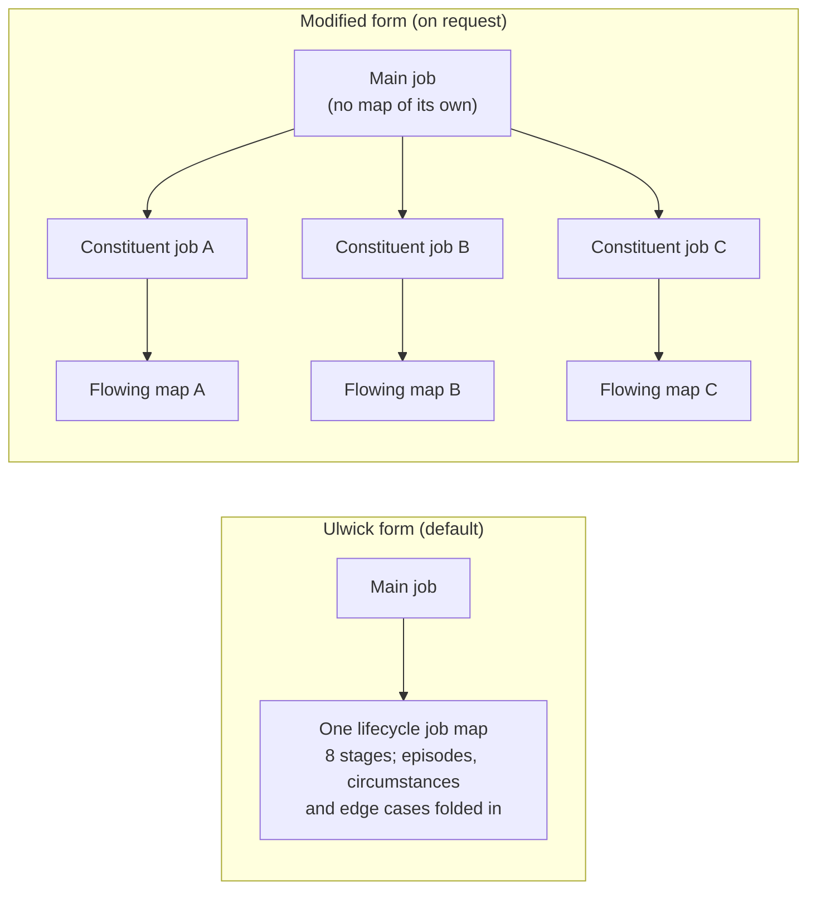
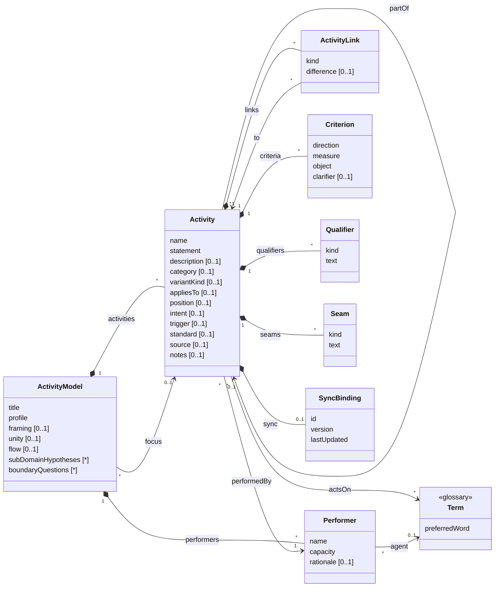

# The job family

This README introduces the family of activity-modelling skills headed by `job-topology`, and sets out their underlying
structure as a domain model, so that the artefacts can be mapped to and from other systems and the same pattern can be
reused for other kinds of activity model. It is not part of any skill: agents work from each skill's `SKILL.md` and
its references, which remain the authority on how the artefacts are built.

## The family

The family models what people in a domain are trying to get done, at the concept level: describing the domain, not a
product. It is oriented around Jobs to be Done in the Outcome-Driven Innovation sense (Ulwick), and written in the
words of the domain's glossary.

| Skill | Answers | Artefact |
|---|---|---|
| **job-topology** (the head) | Who is trying to get what done, and which jobs surround the main one? | One topology per domain: executors, a main job with its episodes (and, in the modified form, constituent jobs), adjacent and related jobs, framing |
| **job-map** | What does it take to get one job done, and how does the executor judge each part done well? | One map per job (Ulwick form), or one per constituent job (modified form): steps by stage, with desired outcomes |
| *scenario* (planned) | Does it hold up against a real case? | Concrete stories traced through a job map in the glossary's words |

They sit beside the `glossary` skill:

- jobs and steps are **verbs on glossary nouns** (*maintain the membership roll*), and executors are agent
  terms;
- the glossary holds the nouns, and only those acts the domain names as things in their own right (*Audit*); the doing
  is modelled here.

What the family shares with the glossary: the domain, not the system; evidence (attested, inferred, proposed) tracked
while drafting and agreement before committing; stopping when it is clear enough for the work at hand; Markdown
documents with a summary table and full entries; no IDs unless synced, and then a YAML block per entry.

Deliberately out of scope, as product-level or heavier than the purpose needs: process flow notations (BPMN), journey
maps and service blueprints, story maps, capability maps, Ulwick's consumption-chain and purchase-decision jobs, and
running opportunity surveys (a map's outcomes are written ready for one).

## Two forms: Ulwick and modified

The family produces a job's maps in one of two forms. The topology records which, on the main job (*Mapping*).

**The Ulwick form (the default).** Canonical Outcome-Driven Innovation: one executor, one core functional job, one job
map. The map covers the whole job over its life. Its eight universal stages (Define, Locate, Prepare, Confirm,
Execute, Monitor, Modify, Conclude) hold the steps the executor must accomplish, typically ten to twenty in all. For a
continuing job, a stage's steps may be carried out continuously, periodically or on demand, and each episode (taking in
a change, a periodic check, a correction) passes through only the stages it needs. Circumstances (a first set-up, a
large organisation, a contested case, a recovery) are contextual modifiers of the stages; edge cases are folded into
the steps they bear on. Nothing spawns a separate map. This is what the skills produce unless asked otherwise, and the
form to use for ODI research and outcome harvesting.

**The modified form (on request).** For when each path through a continuing job is wanted as its own map, flowing from
one beginning to one completion, closer to a process view. The topology divides the main job into **constituent
jobs**, one per path (found by comparing the episodes' immediate results and completions), and each constituent job
gets a flowing map of its own. The main job becomes the higher job they make up, with no map of its own. Constituent
jobs are part of the main job, not different jobs: they share its executor and its ultimate desired result, which is
what separates them from adjacent jobs.

| | Ulwick form (default) | Modified form (on request) |
|---|---|---|
| Unit of analysis | Executor + core functional job | Executor + core functional job, set out through its constituent jobs |
| Maps | One per job, over its life | One per constituent job; none for the main job |
| A map's shape | Eight stages; episodes pass through the stages they need | One progression per map, from its beginning to its completion |
| Episodes | Circumstances of the one map, listed on the main job | Grouped by path; each path is a constituent job |
| Circumstances and edge cases | Variant activities under the steps they change | The same, on the constituent maps they bear on |
| Modify | Adjusts the work, and puts the maintained state right where it has drifted | Adjusts that path only; an error predating it goes to the constituent job that corrects it |
| Related jobs link to | The main job | The main job, or the constituent job they bear on |
| Use for | ODI research, desired outcomes, opportunity surveys | Explaining or designing how each kind of work flows |

Both forms rest on the same **unity test** (what is part of the main job: the same executor and ultimate result) and the
same rules for steps and outcomes. The topology can switch between them: each step and outcome is re-homed one by one.

## A generic activity model

Most activity-modelling techniques share one structure: **units of activity, decomposed into smaller ones, performed
by someone, acting on things the domain names, related to one another, and judged by criteria**. They differ mainly in
what they call the units, which classifications they impose, which links they allow and what constraints they add. The
job topology and the job map are two **profiles** of that structure, and other techniques (at higher or lower
altitudes) can be expressed as further profiles.

In the model below, *Activity* is the generic unit: a job in a topology, a step in a map. It is not the glossary's
Activity kind, which is a word the domain uses; an activity here may involve several such words.

### Notes on the model

| Element | Notes |
|---|---|
| **ActivityModel** | One document: a topology or a job map. `profile` says which, and so which labels and constraints apply. `focus` is the activity the model is about: the main job of a topology, the job a map opens up. `framing` is the opening prose; `unity` records the unity test (what is part of the main job: the parts considered and the ultimate result each serves) and `flow` the form (Ulwick, the default: one lifecycle map; or modified, on request: constituent jobs with flowing maps); in a map, `flow` holds the pre-check; `subDomainHypotheses` (each with the signal that prompted it) and `boundaryQuestions` (left open on purpose, such as whether an obligation completes a change or belongs to a separate job) are kept as lists so they can be found and counted. |
| **Activity** | The generic unit. `name` identifies it within its model (verb + glossary noun); `statement` is the full form; `description` says what it covers (its scope, such as the things a step must establish), without breaking it into sub-activities. `category` is a value from the profile's classification. `position` orders it among its siblings where order matters, loosely. `intent` is the result its performer is pursuing: the desired outcome of the activity as a whole (not to be confused with a `Criterion`, which judges how well a part of it is done). Intent is what distinguishes activities and performers: two activities with the same performer are separate jobs only if their intents differ, and two performers are one only if they pursue the same intent. `trigger` says what sets it off (event-driven, periodic, exceptional) where the profile asks. `standard` is required on an activity whose result is assurance: `Consistency` (agrees with the evidence available) or `Correctness` (the underlying state is right, on sufficient evidence). |
| **partOf** | Decomposition, and the link from a variant to its core activity. An activity in one model may be part of an activity in another: a map's steps are part of a job in the topology. Profiles limit the depth. |
| **Performer** | Who performs an activity, by capacity (the responsibility carried), not title; should resolve to an agent term in the glossary, which marks a coined name as a functional role. `rationale` records what was unified or split, and on what intent. Performers are unified when they pursue the same intent, however different their scale; never because they stand to another activity the same way. |
| **actsOn** | The glossary nouns an activity's statement uses. In the documents these are words in the statement, not a separate field; drift checks compare them with the glossary. |
| **ActivityLink** | A typed link between two activities, other than decomposition: how an adjacent or related job stands to the main job (or to the constituent job it bears on), or a sequence or dependency in other profiles. `difference` records how the two differ, where the profile asks. |
| **Criterion** | How success is judged: a desired outcome in a job map (direction + measure + object + clarifier). |
| **Qualifier** | An emotional or social dimension of the activity; a profile may require qualifiers to be turned into criteria on its parts. |
| **Variants** | A **variant** is an activity that says what another activity must accomplish, or what changes, in a particular case. It is `partOf` the activity it varies (its **core** activity), shares its `category`, and has a `variantKind` other than `Core` and an `appliesTo` naming the case. `variantKind` is profile-defined: the two profiles here use `EdgeCase` (a particular kind of thing the job deals with: *Joint holding*, *Partly paid share*) and `Circumstance` (a situation the whole job is done in: *C1 Incorporation*, *C3 Corporate action*); other profiles may add kinds (a market, a channel, a risk class) without changing the model. Being an activity, a variant can carry its own criteria, seams, source and notes. `appliesTo` is text, kept consistent by rule: an edge case uses the glossary's preferred word, a circumstance its label exactly as listed with the map. A variant never changes the core activity's intent: one that would is a different activity. |
| **Seam** | Where execution leaves any system: it `happensInWorld`, `arrivesFromWorld`, or runs `bothWays` (the act inside gives the change outside its effect, as when entry in a record is what gives a change effect). |
| **SyncBinding** | Present only when synced with an external system; never invented. In the documents it is the YAML block under the entry's heading. |
| **Evidence** | Not in the model: status belongs to drafts (a claim resting on a source not yet read is *proposed*). Open questions are text in `notes`, prefixed `Open:`; related jobs considered and left out are listed in the focus activity's notes. |

### The two profiles

The job topology and the job map are the two profiles; each covers both forms (*Two forms*, above), and the rows
below say where they differ.

| Pattern element | Job topology | Job map |
|---|---|---|
| ActivityModel | Topology (one per domain) | Job map (one per job) |
| focus | The main job | Ulwick form: the main job. Modified form: one of its constituent jobs |
| Activity | Job | Step |
| name / statement | Verb + object / + contextual clarifier | Verb + object (+ clarifier where two steps would read alike) |
| category | `Main`, `Episode`, `Adjacent`, `Related`; `Constituent` in the modified form | `Define`, `Locate`, `Prepare`, `Confirm`, `Execute`, `Monitor`, `Modify`, `Conclude` |
| partOf | Episodes (and, in the modified form, constituent jobs) are part of the main job; other jobs are top-level | Every step is part of the focus job |
| position | Not used | The order an executor describes, loosely |
| Performer | Executor | The job's executor, inherited, never restated |
| ActivityLink | Each related job links to the main job: `Changes`, `Enables`, `Constrains`, `Governs`, `Consumes`, `RespondsTo`. An adjacent job may link `Before`, `After` or `Alongside`, where its place in time helps | `Serves`: a step to each episode of a continuing job that passes through it |
| intent / difference | `intent` on every job (the main job's is its statement); `difference` on every link, stating how the job's intent differs from the main job's and the signal | Not used (steps share the job's intent) |
| trigger | Required on episodes: `EventDriven`, `Periodic`, `Exceptional` | Not used |
| Criterion | Not used: outcomes belong to steps | Desired outcomes, usually two to four per significant step |
| Qualifier | Emotional and social, on jobs | Not recorded: turned into criteria on the steps they bear on |
| variantKind, appliesTo | On the main job: `Circumstance` variants (how the job differs in each circumstance); `EdgeCase` variants recording breadth tests (the statement is what the case showed about the job's object) | Core steps (`variantKind` `Core`, or absent); `EdgeCase` variants (`appliesTo` usually a glossary term; the topology's breadth tests are the first source) and `Circumstance` variants (`appliesTo` one of the circumstances listed with the map, C1, C2, …), each part of the core step it varies and recorded only where that step changes |
| Seam | In the framing and on jobs | On steps |
| subDomainHypotheses, boundaryQuestions | Used | Not used |
| unity, flow | Required on a continuing main job: what is part of it, and which form (`flow`: Ulwick or modified) | `flow` required: the pre-check (which job, which form) |

**Constraints of the job topology**: exactly one main job; only episodes and constituent jobs are part of another
activity, always the main job, and they share its performer and its ultimate result (a constituent job has its own
statement and its immediate result as its intent); an adjacent job has the main job's performer and a different
ultimate result; a related job has a different performer; two related jobs with the same relationship to the main job
but different intents remain separate, each with its own performer; every link runs from an adjacent or related job to
the main job or to the constituent job it bears on, with a kind allowed for its category. A continuing main job records
its unity test (what is part of it, whatever the trigger, frequency, size or source) and its form: the Ulwick
form by default (a single lifecycle map); the modified form only when flowing maps per path are asked for (constituent
jobs, each with its own map, and the main job with none). Episodes are recorded on the main job's entry, not as rows;
constituent jobs, in the modified form, are rows.

**Constraints of the job map**: one focus job, from a topology; every step is part of it and none has parts of its own
(one level of steps; a core step may have variants, which are part of it, share its stage, have a `variantKind` and an
`appliesTo`, and have no variants of their own); every step has the focus job's performer; categories are the eight step types, none filled for its own
sake; criteria take the outcome form. In the Ulwick form (the default), the map covers the whole job over its life: each episode
passes through the stages it needs (the continuity rule), circumstances are contextual modifiers of the steps and edge
cases are folded into them. In the modified form, each constituent job's map is one progression from its beginning to
its completion.

### Other profiles

The same structure fits other activity models by relabelling and constraining it. These are illustrations of the
pattern, not skills in this plugin:

| Technique | Activity is | category | partOf | ActivityLink | Criterion |
|---|---|---|---|---|---|
| Value chain (Porter) | Activity | Primary, support | Optional: activity → sub-activity | Not used | Not used |
| Hierarchical task analysis | Goal, subgoal, operation | Level | Recursive, any depth | Plan (when each sub-task is done) | Performance standard |
| User story map (Patton) | Activity, task, story | Backbone, walking skeleton, release | Activity → task → story | Sequence along the backbone | Acceptance criteria |
| Process model (swimlane, BPMN) | Process, step | Task, decision, event | Process → step | Sequence, condition, message | Service level |
| Event partitioning (essential systems analysis) | Planned response | External, temporal event | Response → step | Triggered by (an event) | Not used |

A profile is defined by: what it calls the model and the activity; its classification; the depth of decomposition;
which link kinds it allows and between what; whether it uses criteria, qualifiers, variants (and which kinds) and seams; and the
constraints that tie them together. Adding a profile is a matter of writing those down, not of changing the model.

## Mapping to other systems

- **Identity.** Use an external system's identifier once it has one (`SyncBinding.id`); until then match on an
  activity's `name` within its model.
- **Hierarchy.** Most tools hold a tree (initiative → epic → story, process → step, job → step). Map `partOf` to it and
  `category` to a type or tag, and keep the profile so the tree can be read back with the right labels.
- **Variants.** Map a variant to a child record, note or conditional field of its core activity, keeping its
  `variantKind` and `appliesTo` (as a tag or condition). Where the target has none of these, write variants into the
  core activity's description as `<appliesTo>: <statement>`, so they can be read back.
- **Links.** Keep the link kind; where the target has only untyped links, carry the kind in a custom attribute.
- **Outcomes.** Tools built around Outcome-Driven Innovation hold jobs, steps and outcomes natively; elsewhere outcomes
  map to child records or a structured field of their step, never pooled at the job.
- **Versions.** Before pushing, compare `version` or `lastUpdated` with the external record and stop on a mismatch.
